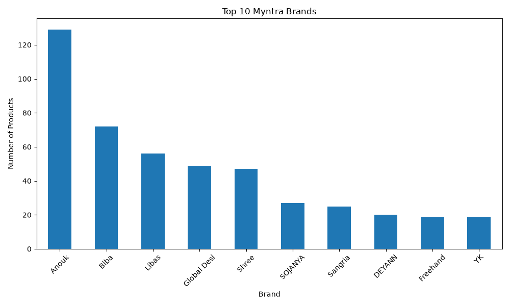

# Myntra Data Analysis Project

## About the Project
This project analyzes Myntra product data using Python and Pandas.

## Dataset
The dataset is stored in the `train.csv` file.

## Tools Used
- Python
- Pandas
- Data Analysis

## Project Features
- Display the first five rows of data
- Check dataset information
- Count rows and columns
- View column names
- Check missing values

## How to Run
## Top 10 Brands Analysis

- Identifies the top 10 brands in the Myntra dataset.
- Counts the number of products for each brand.
- Uses Python and Pandas for data analysis.

## Price Analysis

- Calculates the average product price.
- Identifies the minimum and maximum product prices.
- Helps understand product pricing patterns.

## Project Output

The project includes a visualization of the top 10 brands.

1. Download the project files.
2. Install Pandas using `pip install pandas`.
3. Run the Python file using `python myntra_analysis.py`.

## Author
Myntra Data Analysis Project
